# NovaUI

> A modern, professional UI control library for **Windows Forms (.NET Framework 4.7.2+)**
> 50+ customizable controls with smooth animations, full RTL/LTR support, a built-in theme system, and a native **Icon Gallery** with **9,000+ icons**.

[](https://dotnet.microsoft.com/)
[](LICENSE)
[]()
[]()
[]()
[](https://www.nuget.org/packages/NovaUI.WinForms)
[](https://www.nuget.org/packages/NovaUI.WinForms)

---

## Table of Contents

- [Introduction](#introduction)
- [Features](#features)
- [Requirements](#requirements)
- [Installation](#installation)
- [Icon Gallery — Killer Feature](#icon-gallery--killer-feature)
- [Controls Catalog](#controls-catalog)
- [Control Reference (with previews)](#control-reference-with-previews)
  - [Inputs](#inputs-1)
  - [Buttons](#buttons-1)
  - [Panels & Containers](#panels--containers-1)
  - [Feedback](#feedback-1)
  - [Display](#display-1)
  - [Layout](#layout-1)
  - [Data](#data-1)
  - [Dialogs](#dialogs-1)
  - [Chat & Notifications](#chat--notifications-1)
  - [Forms](#forms-1)
- [Theming](#theming)
- [RTL / LTR Support](#rtl--ltr-support)
- [Design-Time Experience](#design-time-experience)
- [Helpers](#helpers)
- [Project Structure](#project-structure)
- [Best Practices](#best-practices)
- [FAQ](#faq)
- [License](#license)
- [Author](#author)

---

## Introduction

**NovaUI** is a comprehensive UI control library for **Windows Forms (.NET Framework)** designed to bring modern design to desktop applications. Every control is:

- 🎨 Fully customizable via **Properties Window** — no code needed
- 🌍 RTL/LTR-ready out of the box
- ✨ Animated with smooth easing
- 🛡️ Design-time safe (no designer crashes)
- 📦 Drop-in replacement for standard WinForms controls

Whether you're building a POS system, an admin dashboard, or a business application, NovaUI gives you the building blocks.

---

## Features

### Core

- 🎁 **35+ professional controls** — inputs, buttons, panels, dialogs, data views
- 🖼️ **Icon Gallery with 9,000+ icons** — pick any icon visually from a full-screen Form
- 🌍 **Full RTL/LTR support** — every control respects `RightToLeft`
- 🛡️ **Design-time safe** — no designer crashes, all controls in Toolbox
- 🔧 **Complete Properties Window support** — customize without code
- 📦 **Single DLL** — reference once, use everywhere
- ⚡ **Hardware accelerated** — `DoubleBuffered` + `AntiAlias`

### Icon Gallery

- 🎨 **9,000+ icons** ready to use
- 🖱️ **Visual picker** opens when clicking `...` on any `IconGlyph` property
- 🔍 **Live search** — filter by keyword instantly
- 📂 **Multiple icon packs** supported
- 🎯 **Direct insert** into the property
- 💾 **No external dependencies** — icons embedded

---

## Requirements

| Requirement        | Version                                          |
| ------------------ | ------------------------------------------------ |
| **Windows**        | 7 SP1 or later (Windows 10/11 recommended)       |
| **.NET Framework** | 4.7.2 or higher                                  |
| **Visual Studio**  | 2019 or 2022 or 2026 (Community edition is fine) |
| **Font**           | `Segoe MDL2 Assets` (built into Windows 10/11)   |

---

## Installation

NovaUI is available as a **NuGet package** — the fastest way to install it.

### 📦 Install via NuGet (Recommended)

**Package ID:** `NovaUI.WinForms`
**NuGet Page:** [nuget.org/packages/NovaUI.WinForms](https://www.nuget.org/packages/NovaUI.WinForms)

### Step 1 — Build the Library

1. Open `NovaUI.sln` in **Visual Studio**.
2. Set configuration to **Release**.
3. Right-click `NovaUI` → **Build**. <br>
   or Download Release DLL File in Github Page
4. Locate the DLL:

```
NovaUI\bin\Release\NovaUI.dll
```

5.  Copy the DLL to a safe location (e.g., `C:\Libraries\NovaUI\`).

### Step 2 — Reference the DLL

**Option A — Browse**

1. Open your Windows Forms project.
2. **Solution Explorer** → right-click **References** → **Add Reference…**
3. **Browse** tab → select `NovaUI.dll` → **OK**.

**Option B — Project Reference**

1. Put the `NovaUI` project inside your solution.
2. **References** → **Add Reference…** → **Projects** tab → check `NovaUI`.

**Option C — libs folder (Team/Git)**

```
NovaUI/
├── libs/
│   └── NovaUI.dll
└── NovaUI.csproj
```

### Step 3 — Add Controls to Toolbox

1. Open **Toolbox** (`Ctrl + Alt + X`).
2. Right-click any tab → **Add Tab** → name it `NovaUI`.
3. Right-click inside the tab → **Choose Items…**
4. **Browse…** → select `NovaUI.dll` → all controls are checked → **OK**.
5. All controls are now draggable onto any form.

### 🛠️ Manual Installation (Optional)

If you prefer not to use NuGet:

1. Build the `NovaUI` project in **Release** mode.
2. Locate `NovaUI\bin\Release\NovaUI.dll`.
3. Reference it in your project:
   - **Solution Explorer** → right-click **References** → **Add Reference…** → **Browse** → select the DLL.

### Step 4 — Use in Your Project

```csharp
using NovaUI;
using System.Drawing;
using System.Windows.Forms;

public partial class MainForm : Form
{
    public MainForm()
    {
        Size = new Size(1000, 700);
        BackColor = Theme.Background;

        var txt = new NovaTextBox
        {
            Location = new Point(40, 40),
            Size = new Size(320, 52),
            PlaceholderText = "Username",
            IconGlyph = "\uE77B"
        };

        var btn = new NovaButton
        {
            Location = new Point(40, 110),
            Size = new Size(320, 50),
            Text = "Sign in",
            BorderRadius = -1
        };
        btn.Click += (s, e) => NovaToast.Success(this, "Welcome back!");

        Controls.Add(txt);
        Controls.Add(btn);
    }
}
```

---

## Icon Gallery — Killer Feature

NovaUI ships with a **built-in Icon Gallery** containing **9,000+ icons**.

### How It Works

Every control with an icon property (like `IconGlyph`) exposes a **`...`** button in the Properties Window. Clicking it opens a **full icon picker Form**.


### Features

| Feature            | Description                                  |
| ------------------ | -------------------------------------------- |
| **Live search**    | Type "user" → only user icons show           |
| **Multiple packs** | Segoe MDL2, Font Awesome, Bootstrap Icons, … |
| **Live preview**   | See the icon rendered before inserting       |

### How to Use

1. In **Properties Window**, click on any `IconGlyph` property.
2. A **`...`** button appears on the right.
3. Click it → the **Icon Gallery Form** opens.
4. Search, browse, or select from favorites.
5. Click an icon → the glyph code is inserted automatically.

### Icon Packs Included

| Pack             | Icons | Pack         | Icons     |
| ---------------- | ----- | ------------ | --------- |
| FALCON Pack 1    | 2001  | System Icons | 348       |
| General Filled 3 | 1053  | Logos        | 300       |
| FALCON Pack 2    | 699   | Media        | 296       |
| Brands 1         | 606   | Documents    | 244       |
| General Pack 2   | 562   | Design       | 236       |
| Brands 2         | 501   | Business     | 220       |
| General Pack 1   | 491   | Devices      | 192       |
| Arrows           | 178   | Finance      | 172       |
| Map              | 172   | Editor       | 151       |
| ...              | ...   | **Total**    | **9,061** |

---

## Controls Catalog

### Inputs

| Control            | Description                                   |
| ------------------ | --------------------------------------------- |
| `NovaTextBox`      | Modern text field with icon + password toggle |
| `NovaNumberBox`    | Numeric input with up/down buttons            |
| `NovaComboBox`     | Dropdown with shadowed popup                  |
| `NovaDatePicker`   | Date field with calendar popup                |
| `NovaSlider`       | Range slider with tooltip                     |
| `NovaCheckBox`     | Animated checkmark checkbox                   |
| `NovaToggleSwitch` | iOS-style toggle                              |
| `NovaTagInput`     | Multi-tag input with suggestions              |
| `NovaMultiSelect`  | Multi-select chips dropdown                   |
| `NovaSearchBox`    | Search field with suggestions                 |

### Buttons

| Control           | Description                     |
| ----------------- | ------------------------------- |
| `NovaButton`      | Rounded button with hover/press |
| `NovaRadioButton` | Custom radio button with dot    |

### Panels & Containers

| Control     | Description                 |
| ----------- | --------------------------- |
| `NovaPanel` | Rounded panel with gradient |
| `NovaCard`  | Card with header and shadow |

### Feedback

| Control              | Description         |
| -------------------- | ------------------- |
| `NovaToast`          | Toast notification  |
| `NovaModalDialog`    | Modern modal dialog |
| `NovaLoadingSpinner` | Rotating spinner    |
| `NovaProgressBar`    | Linear progress bar |

### Display

| Control                | Description                |
| ---------------------- | -------------------------- |
| `NovaAlert`            | Inline alert message       |
| `NovaAvatar`           | Circular avatar            |
| `NovaBadge`            | Small status badge         |
| `NovaChip`             | Removable tag chip         |
| `NovaCircularProgress` | Circular progress ring     |
| `NovaPicture`          | Image with rounded corners |
| `NovaIcon`             | Custom icon from glyph     |

### Layout

| Control         | Description                 |
| --------------- | --------------------------- |
| `NovaSidebar`   | Vertical navigation sidebar |
| `NovaToolbar`   | Toolbar with dropdowns      |
| `NovaStatusBar` | Status bar with items       |

### Data

| Control            | Description             |
| ------------------ | ----------------------- |
| `NovaDataGridView` | Enhanced grid with RTL  |
| `NovaTreeList`     | Tree + columns grid     |
| `NovaListBox`      | Custom list             |
| `NovaChart`        | Bar / Line / Area chart |

### Dialogs

| Control                | Description                |
| ---------------------- | -------------------------- |
| `NovaColorPicker`      | Full color picker          |
| `NovaContextMenuStrip` | Modern context menu        |
| `NovaFilePicker`       | File picker with drag-drop |

### Forms

| Control          | Description                   |
| ---------------- | ----------------------------- |
| `NovaCustomForm` | Custom Windows DWI Round Form |

---

## Control Reference (with previews)

### Inputs

#### NovaTextBox

Modern text input with leading icon, placeholder, and optional password toggle.

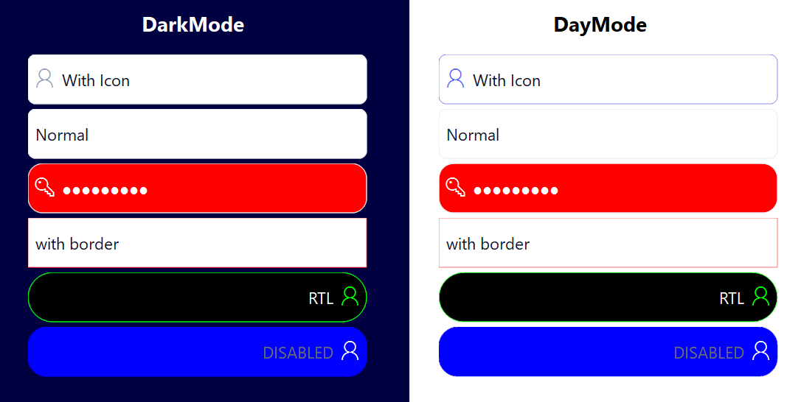

**Key Properties**: `PlaceholderText`, `IconGlyph`, `IsPassword`, `ShowToggle`, `Radius`, `FillColor`, `FocusFillColor`, `BorderColor`, `FocusBorderColor`.

**Events**: `TextChanged`.

---

#### NovaNumberBox

Numeric input with inline up/down buttons and optional prefix/suffix.

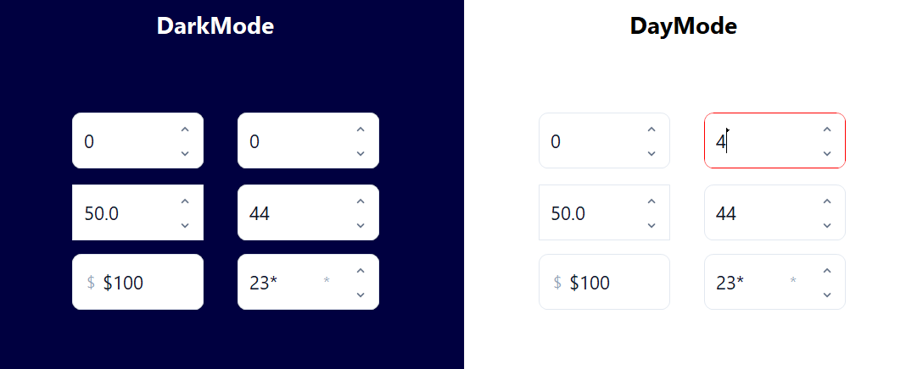

**Key Properties**: `Minimum`, `Maximum`, `Value`, `Step`, `Decimals`, `Prefix`, `Suffix`, `ShowButtons`, `UseThousandsSeparator`.

**Events**: `ValueChanged`.

---

#### NovaComboBox

Dropdown with animated arrow, shadowed popup, and RTL-aware text.

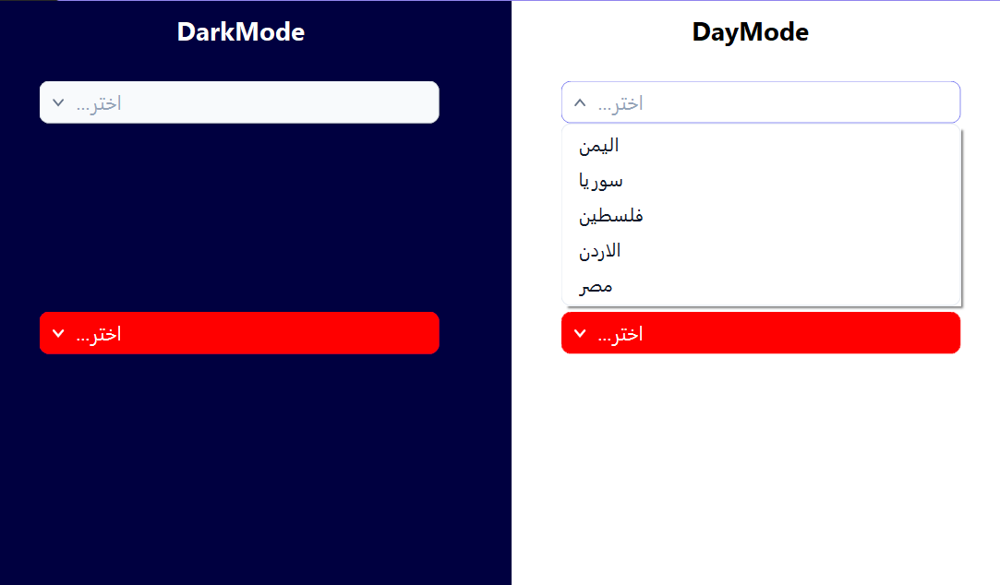

**Key Properties**: `Items`, `SelectedIndex`, `PlaceholderText`, `BorderRadius`, `ItemHeight`, `MaxDropDownHeight`.

**Events**: `SelectedIndexChanged`.

---

#### NovaDatePicker

Date field with a built-in calendar popup.

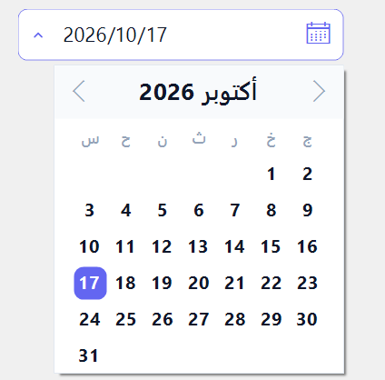

**Key Properties**: `Value`, `DateFormat`, `BorderRadius`.

**Events**: `ValueChanged`.

---

#### NovaSlider

Single-thumb slider with a value tooltip.

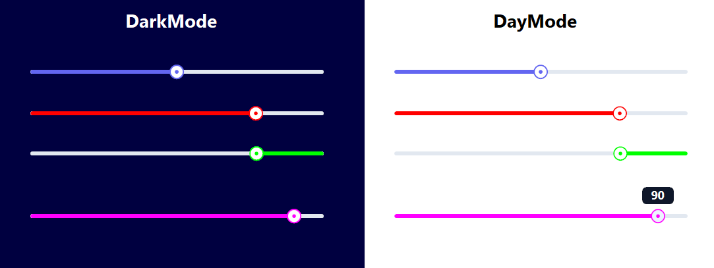

**Key Properties**: `Minimum`, `Maximum`, `Value`, `ThumbSize`, `TrackHeight`, `ShowTooltip`, `ProgressColor`.

**Events**: `ValueChanged`.

---

#### NovaCheckBox

Checkbox with an animated checkmark and full color control.

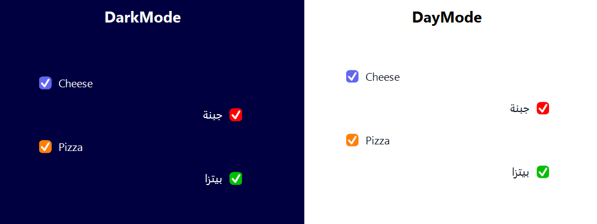

**Key Properties**: `Checked`, `BoxSize`, `BoxRadius`, `CheckedFill`, `CheckMarkColor`.

**Events**: `CheckedChanged`.

---

#### NovaToggleSwitch

iOS-style toggle switch with an animated thumb.

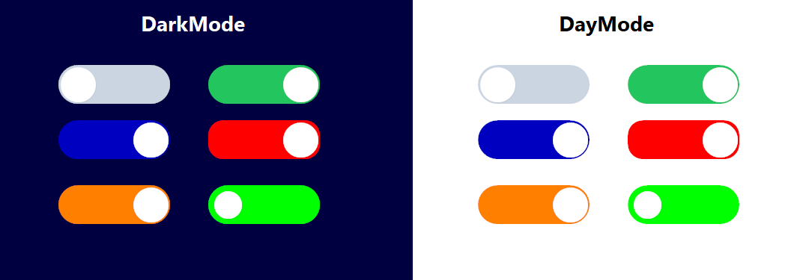

**Key Properties**: `Checked`, `OnColor`, `OffColor`, `ThumbColor`.

**Events**: `CheckedChanged`.

---

#### NovaTagInput

Multi-tag input with autocomplete suggestions and removable chips.

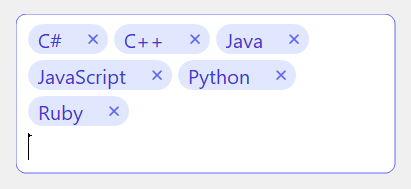

**Key Properties**: `Tags`, `Suggestions`, `PlaceholderText`, `BorderRadius`, `TagHeight`, `AddOnComma`, `AddOnSemicolon`, `MaxTags`.

**Events**: `TagsChanged`, `TagAdded`, `TagRemoved`, `ValidationFailed`.

---

#### NovaMultiSelect

Multi-select dropdown with chips display and search inside.

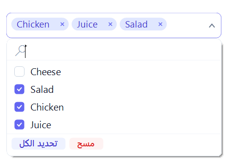

**Key Properties**: `Items`, `SelectedItems`, `MaxDisplayChips`, `OverflowFormat`, `PlaceholderText`.

**Events**: `SelectionChanged`.

---

#### NovaSearchBox

Search field with icon, clear button, suggestions popup, and loading state.

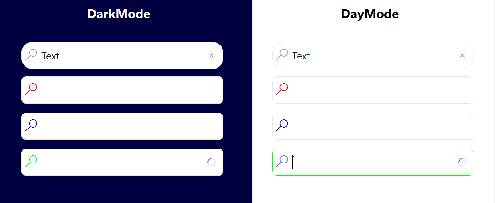

**Key Properties**: `PlaceholderText`, `IconGlyph`, `IsLoading`, `Suggestions`, `DebounceMs`.

**Events**: `SearchRequested`, `SearchTextChanged`, `SuggestionSelected`.

---

#### NovaFilePicker

File picker with drag-and-drop, chips, and file-type icons.

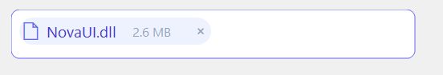

**Key Properties**: `Filter`, `Multiselect`, `MaxFiles`, `MaxFileSize`, `AllowFileDrop`, `ShowFileIcon`, `ShowFileSize`.

**Events**: `FilesChanged`, `FileAdded`, `FileRemoved`, `ValidationFailed`.

---

### Buttons

#### NovaButton

Rounded button with hover/press/disabled states, gradient, and icon.

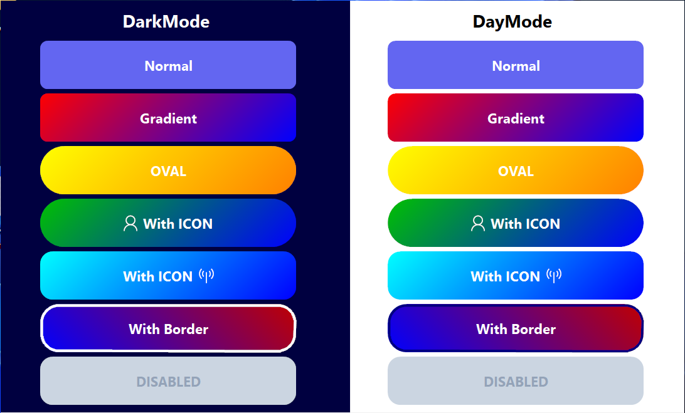

**Key Properties**: `BorderRadius`, `NormalColor`, `HoverColor`, `PressColor`, `DisabledColor`, `GradientEnabled`, `IconGlyph`, `IconSpacing`, `IconOnRight`.

**Events**: `Click`.

---

#### NovaRadioButton

Radio button with an animated inner dot.

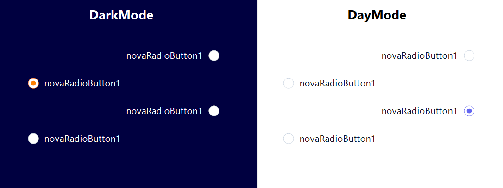

**Key Properties**: `Checked`, `CircleSize`, `CheckedBorder`, `DotColor`.

**Events**: `CheckedChanged`.

---

### Panels & Containers

#### NovaPanel

Rounded panel with optional gradient and border.

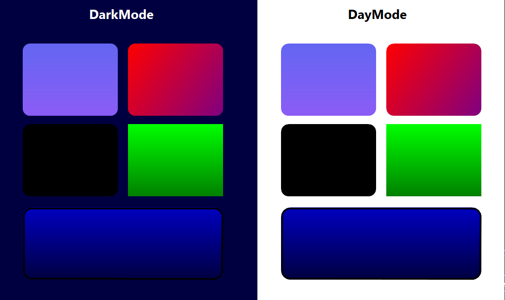

**Key Properties**: `BorderRadius`, `FillColor`, `BorderColor`, `BorderSize`, `GradientEnabled`, `GradientColor1`, `GradientColor2`, `GradientAngle`.

---

#### NovaCard

Content card with header (title + icon + separator) and shadow.

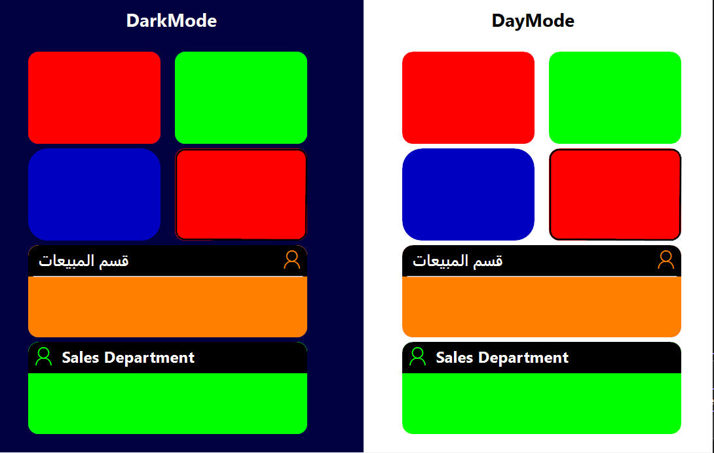

**Key Properties**: `HeaderText`, `HeaderIcon`, `HeaderHeight`, `BorderRadius`, `FillColor`, `BorderColor`.

---

### Feedback

#### NovaToast

Non-blocking toast notifications that stack and auto-dismiss.

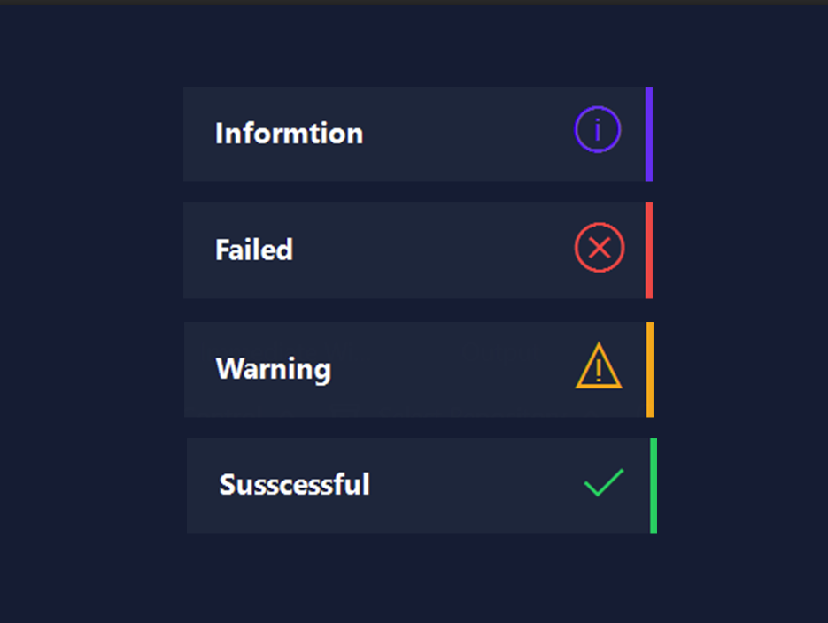

**Static API**:

```csharp
NovaToast.Success(this, "Saved successfully");
NovaToast.Error(this,   "Connection failed");
NovaToast.Warning(this, "Session expiring soon");
NovaToast.Info(this,    "You have 3 new messages");
```

---

#### NovaModalDialog

Modern modal dialog with a dark backdrop and fade-in.

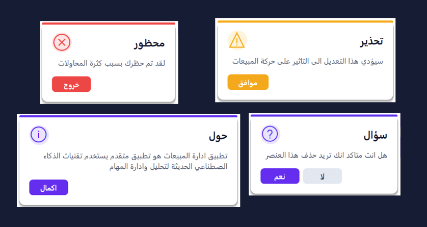

**Static API**:

```csharp
bool ok = NovaModalDialog.Confirm(this, "Delete", "Are you sure?",
    DialogType.Warning, "Delete", "Cancel");
```

**DialogType**: `Info`, `Success`, `Warning`, `Error`, `Question`.

---

#### NovaAlert

Inline alert with icon, title, message, and optional action.

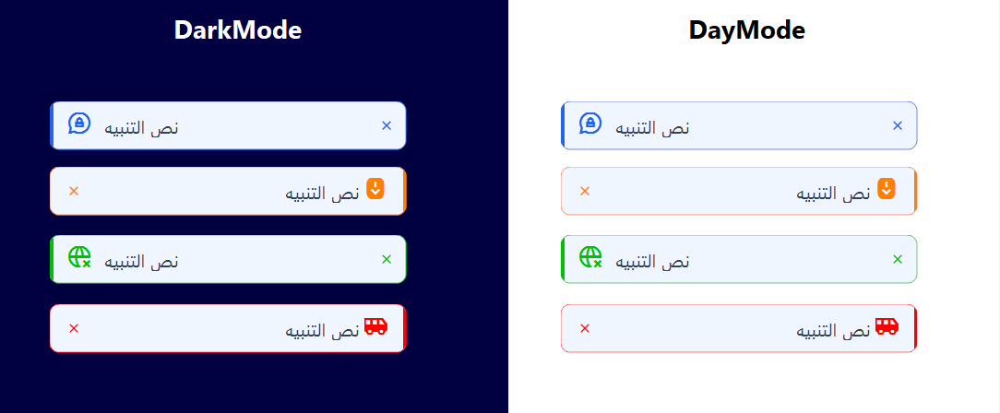

**Key Properties**: `Type` (`Info`, `Success`, `Warning`, `Danger`, `Neutral`), `Title`, `Message`, `Dismissible`, `ActionText`.

**Events**: `AlertClosed`, `ActionClicked`.

---

#### NovaLoadingSpinner

Rotating arc spinner with adjustable speed and sweep.

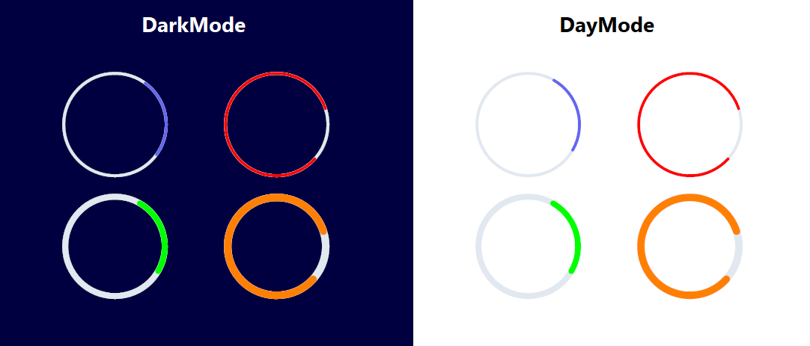

**Key Properties**: `Thickness`, `SpinnerColor`, `TrackColor`, `Speed`, `Sweep`.

---

### Display

#### NovaAvatar

Circular avatar with initials, image, ring, and status dot.

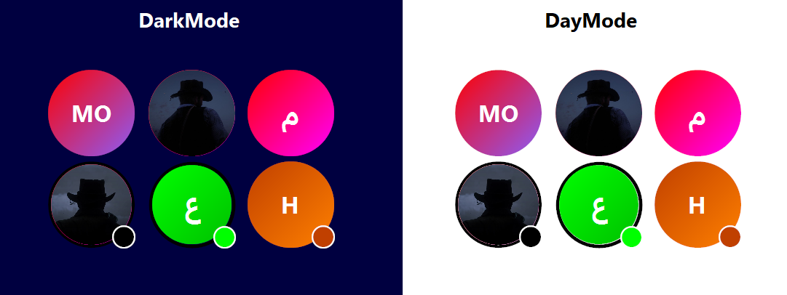

**Key Properties**: `Image`, `Initials`, `RingThickness`, `RingColor`, `StatusColor`, `StatusSize`, `GradientBackground`.

---

#### NovaBadge

Small status badge (Solid / Soft / Outline).

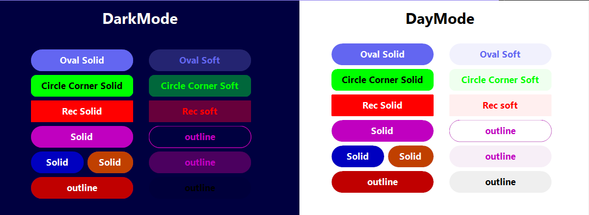

**Key Properties**: `BadgeText`, `Style`, `AccentColor`, `TextColor`, `BorderRadius`.

---

#### NovaChip

Removable tag chip with optional icon.

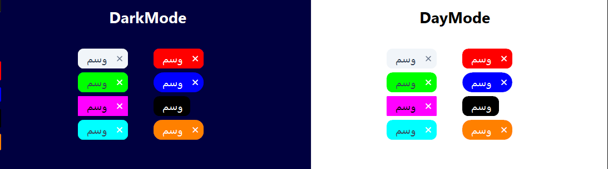

**Key Properties**: `ChipText`, `IconGlyph`, `Removable`, `FillColor`, `CloseColor`.

**Events**: `Removed`, `ChipClicked`.

---

#### NovaCircularProgress

Animated circular progress ring with percentage.

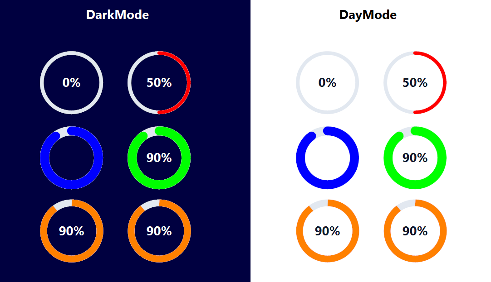

**Key Properties**: `Value`, `Maximum`, `Thickness`, `ProgressColor`, `ShowPercentage`, `RoundedCaps`.

---

#### NovaProgressBar

Linear progress bar (Solid / Striped / Indeterminate / Gradient).

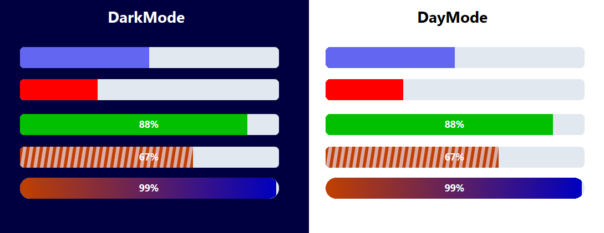

**Key Properties**: `Value`, `Style`, `BorderRadius`, `FillColor`, `FillColor2`, `ShowPercentage`.

#### NovaPicture

Image display with rounded corners, hover overlay, and placeholder.

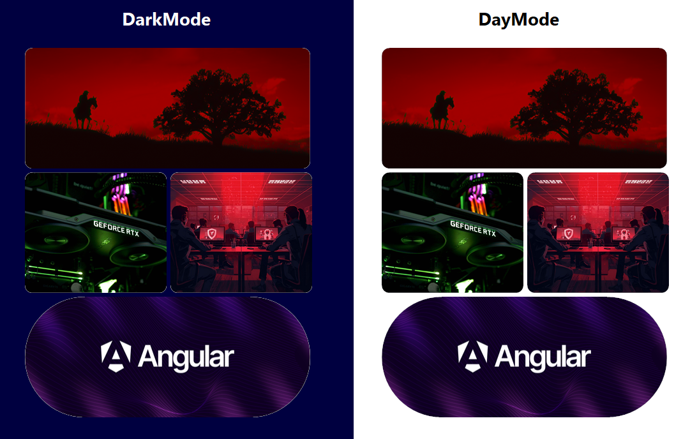

**Key Properties**: `Image`, `ImageLocation`, `SizeMode`, `BorderRadius`, `HoverOverlayEnabled`, `Clickable`.

**Events**: `ImageClicked`.

---

### Layout

#### NovaSidebar

Vertical navigation sidebar with icons, badges, and active indicator.

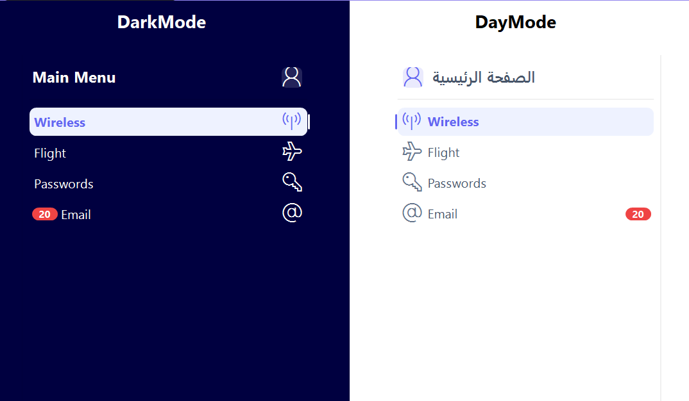

**Key Properties**: `Items`, `SelectedIndex`, `ItemHeight`, `HeaderText`, `HeaderIcon`, `RightToLeft` (auto RTL).

**Events**: `ItemSelected`.

---

#### NovaToolbar

Toolbar with buttons, toggles, labels, separators, and dropdowns.

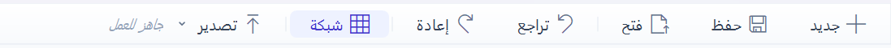

**Key Properties**: `Items`, `ToolbarHeight`, `ItemHeight`, `ItemPadding`, `ItemsAlignment`, `GradientEnabled`.

**Events**: `ItemClicked`, `ItemCheckedChanged`, `ItemHover`.

---

#### NovaStatusBar

Status bar with left/center/right groups and a live clock.

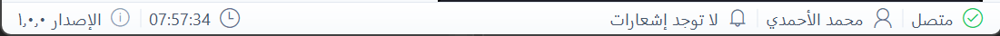

**Key Properties**: `Items`, `BarHeight`, `ShowClock`, `ClockFormat`, `ShowSeparators`, `ItemHoverEnabled`.

**Events**: `ItemClicked`, `ItemHover`.

---

### Data

#### NovaDataGridView

Enhanced grid with rounded border, custom header, hover, and RTL.

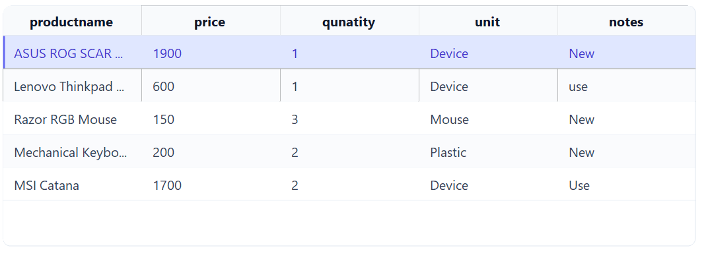

**Key Properties**: `BorderRadius`, `HeaderBackColor`, `HeaderGradient`, `RowHeightCustom`, `CellPaddingCustom`, `ShowRowHover`, `ShowSelectionLeftBorder`.

---

#### NovaListBox

Custom list with icons, descriptions, and multi-select.

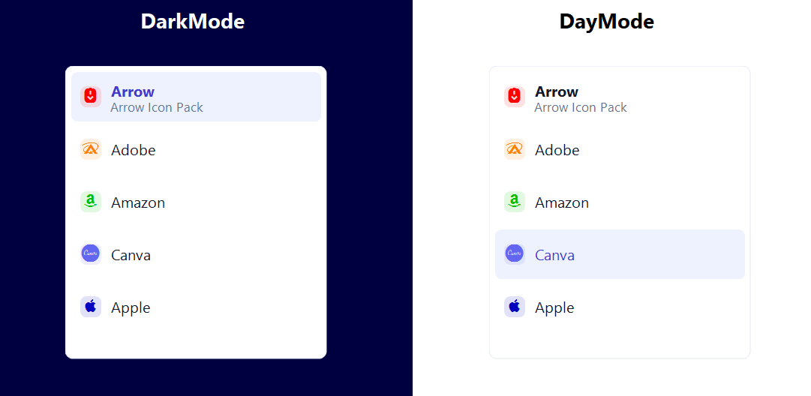

**Key Properties**: `Items`, `SelectedIndex`, `MultiSelect`, `ShowCheckboxes`, `ItemHeight`.

**Events**: `SelectedIndexChanged`, `ItemDoubleClicked`.

---

#### NovaChart

Simple Bar / Line / Area chart.

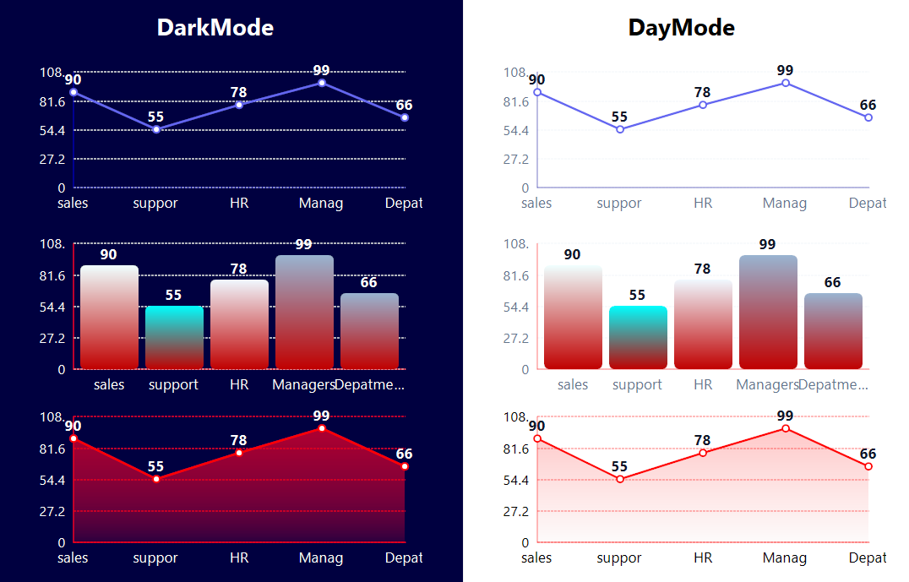

**Key Properties**: `Data`, `ChartType`, `ChartColor`, `ShowGrid`, `ShowValues`, `ShowLabels`, `GradientFill`.

---

### Dialogs

#### NovaColorPicker

Full color picker with SV area, hue, alpha, HEX, and preview.

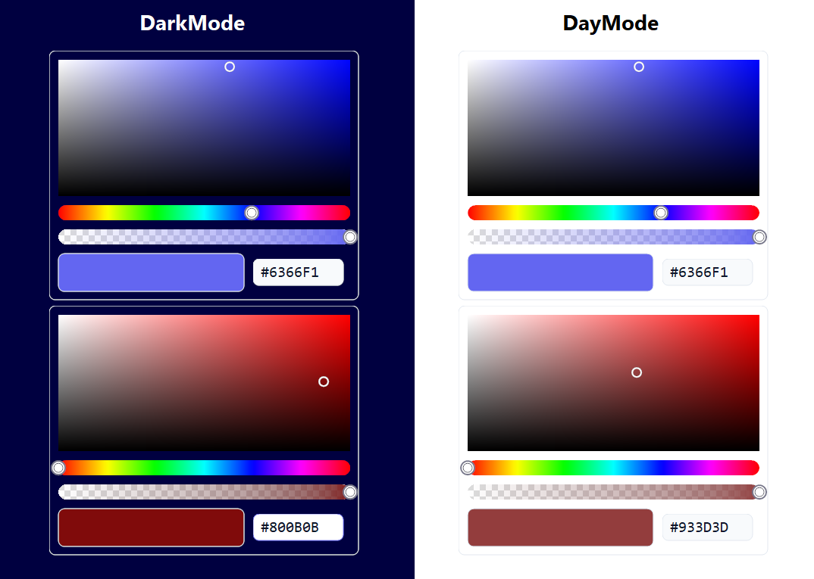

**Key Properties**: `SelectedColor`, `Alpha`, `BorderRadius`.

**Events**: `ColorChanged`.

---

## RTL / LTR Support

Every control respects `RightToLeft`:

```csharp
// Arabic — sidebar on right, icons on right
form.RightToLeft = RightToLeft.Yes;
sidebar.RightToLeft = RightToLeft.Yes;

// English — sidebar on left
form.RightToLeft = RightToLeft.No;
```

| Control            | RTL Behavior                  |
| ------------------ | ----------------------------- |
| `NovaSidebar`      | Icons on right, text on right |
| `NovaDataGridView` | Columns reverse order         |
| `NovaToolbar`      | Items start from right        |
| `NovaStatusBar`    | Left group becomes right      |
| `NovaTagInput`     | Tags start from right         |
| `NovaTreeList`     | Expand arrow on right         |
| `NovaSnackbar`     | Icon on right, action on left |
| `NovaTabControl`   | Tabs reverse order            |

---

## Design-Time Experience

NovaUI is designed to be used **without writing any code**. All properties are exposed in the **Properties Window** with:

- **Category grouping** (e.g., `NovaButton - Colors`)
- **Descriptions** (tooltips on hover)
- **Default values** (bold/normal distinction)
- **Collection Editors** for lists
- **Icon Gallery** for icon properties

### Example — Customizing a Button from Properties

```
Category "NovaButton - Shape"
├── BorderRadius          : 12
├── BorderSize            : 0
└── BorderColor           : #6366F1

Category "NovaButton - Colors"
├── NormalColor           : #6366F1
├── HoverColor            : #4F46E5
├── PressColor            : #4338CA
├── DisabledColor         : #CBD5E1
├── TextColor             : White
├── HoverTextColor        : White
└── DisabledTextColor     : #94A3B8

Category "NovaButton - Gradient"
├── GradientEnabled       : False
├── GradientColor1        : #6366F1
├── GradientColor2        : #8B5CF6
└── GradientAngle         : 45

Category "NovaButton - Icon"
├── IconGlyph             : \uE74E     [ ... ]   ← click for Icon Gallery
├── IconSize              : 14
├── IconSpacing           : 8
└── IconOnRight           : False
```

---

## Project Structure

```
NovaUI/
│
├── NovaUI.csproj
├── NovaUI.sln
├── README.md
├── LICENSE
│
├── docs/
│   └── images/                ← All control screenshots
│
├── Helpers/
│   ├── Animator.cs
│   ├── Gfx.cs
│   ├── DesignHelper.cs
│   └── Theme.cs
│
├── Inputs/                    ← 9 input controls
├── Buttons/                   ← 3 button controls
├── Panels/                    ← 2 panel controls
├── Feedback/                  ← 4 feedback controls
├── Display/                   ← 7 display controls
├── Layout/                    ← 4 layout controls
├── Data/                      ← 4 data controls
├── Dialogs/                   ← 3 dialog controls
├── Chat/                      ← 2 chat controls
├── Forms/                     ← 1 form controls
│
└── IconGallery/
    ├── NovaIconPickerEditor.cs
    ├── NovaIconGalleryForm.cs
    ├── IconPacks/
    └── Resources/
```

---

## Best Practices

### 🎨 Use the Theme system

```csharp
// ✅ Good
btn.NormalColor = Theme.Primary;
lbl.ForeColor   = Theme.TextPrimary;

// ❌ Avoid
btn.NormalColor = Color.FromArgb(99, 102, 241);
```

### 🖼️ Use the Icon Gallery

Instead of typing glyph codes manually, click `...` on any `IconGlyph` property and pick visually.

### 🌍 Design for RTL from the start

```csharp
// Set at form level
this.RightToLeft = RightToLeft.Yes;
```

Everything else adapts automatically.

### 🛡️ Protect against designer crashes

Wrap complex `OnPaint` logic in `DesignHelper.IsDesignTime` checks.

### ⚡ For large data — enable VirtualMode

```csharp
grid.VirtualMode = true;
grid.RowCount = _data.Count;
grid.CellValueNeeded += (s, e) => e.Value = _data[e.RowIndex][e.ColumnIndex];
```

### 📦 Rebuild after every change

Because Visual Studio caches Toolbox items:

1. **Build** (`Ctrl + Shift + B`)
2. Close any open form designs
3. Re-add the DLL via **Choose Items…**
4. Or restart VS if items don't refresh

---

## FAQ

**Q: Controls don't appear in the Toolbox after building.**
A: Right-click Toolbox → **Choose Items…** → **Browse** → select the **latest** DLL. If still missing, close VS and delete `%LocalAppData%\Microsoft\VisualStudio\<version>\ComponentModelCache`.

**Q: Icons show as squares (□).**
A: You're on Windows 7/8 without `Segoe MDL2 Assets`. Upgrade to Windows 10/11, or use an alternative icon pack from the Icon Gallery.

**Q: How do I open the Icon Gallery?**
A: Click on any `IconGlyph` property in the Properties Window — a **`...`** button appears. Click it.

**Q: Can I add my own icons to the gallery?**
A: Yes — create a new `IconPack` class implementing `IIconPack` and register it in `NovaIconGalleryForm`.

**Q: `Parent.BackColor` throws NullReferenceException.**
A: All controls check `Parent != null`. If this happens, ensure the control is added to a parent before setting colors.

**Q: Controls look stretched / misaligned.**
A: Make sure `AutoScaleMode = AutoScaleMode.None` on the host Form.

**Q: Can I use this in .NET 6/7/8?**
A: This version targets `.NET Framework 4.7.2+`. A .NET 6+ port is planned.

**Q: The animations feel slow.**
A: Adjust the duration in each control (e.g., `Animator.Animate(..., durationMs: 150, ...)`) or disable via a global flag.

---

## License

This project is licensed under the **MIT License** — see the [LICENSE](LICENSE) file for details.

```
MIT License

Copyright (c) 2026 NovaUI

Permission is hereby granted, free of charge, to any person obtaining a copy
of this software and associated documentation files (the "Software"), to deal
in the Software without restriction, including without limitation the rights
to use, copy, modify, merge, publish, distribute, sublicense, and/or sell
copies of the Software, and to permit persons to whom the Software is
furnished to do so, subject to the following conditions:

The above copyright notice and this permission notice shall be included in all
copies or substantial portions of the Software.

THE SOFTWARE IS PROVIDED "AS IS", WITHOUT WARRANTY OF ANY KIND, EXPRESS OR
IMPLIED, INCLUDING BUT NOT LIMITED TO THE WARRANTIES OF MERCHANTABILITY,
FITNESS FOR A PARTICULAR PURPOSE AND NONINFRINGEMENT. IN NO EVENT SHALL THE
AUTHORS OR COPYRIGHT HOLDERS BE LIABLE FOR ANY CLAIM, DAMAGES OR OTHER
LIABILITY, WHETHER IN AN ACTION OF CONTRACT, TORT OR OTHERWISE, ARISING FROM,
OUT OF OR IN CONNECTION WITH THE SOFTWARE OR THE USE OR OTHER DEALINGS IN THE
SOFTWARE.
```

---

## Author

**NovaUI** — Built with ❤️ for Windows Forms developers.

- 🐙 GitHub: [github.com/FALAHFATHEL/NovaUI](https://github.com/FALAHFATHEL/NovaUI)
- 💼 LinkedIn: [linkedin.com/in/falah-fathel](https://linkedin.com/in/falah-fathel)
- 📧 Email: falahfathel775@example.com

---

---

<p align="center">
  <strong>NovaUI</strong> — Modern Windows Forms Controls<br>
  Made with ❤️ in 2026
</p>
